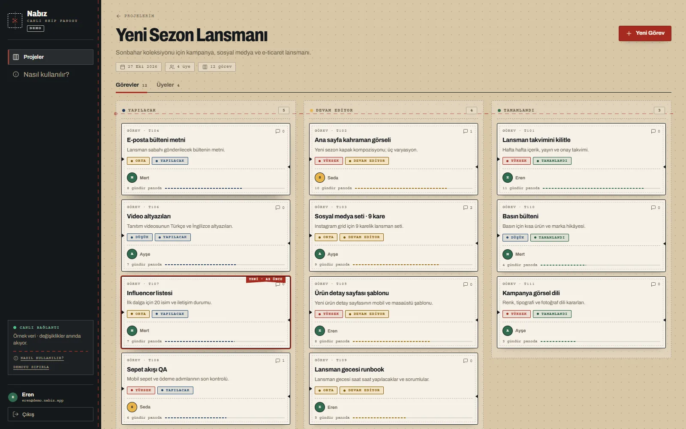

# Nabız



> **Not:** Bu proje hâlâ geliştirme aşamasındadır.

**Nabız**, küçük ekipler için canlı bir proje ve görev panosudur. **ASP.NET Core Web API (.NET 10)** ile **Clean Architecture** prensiplerine uygun olarak geliştirilmiş, **React + Vite** frontend'e sahiptir.

> Kod içindeki `TaskTracker.*` namespace ve proje adları geriye dönük uyumluluk için korunmuştur; kullanıcıya görünen ürün adı **Nabız**'dır.

## Tech Stack

- **ASP.NET Core Web API** - RESTful API
- **Entity Framework Core** - ORM (PostgreSQL)
- **JWT Authentication** - Token tabanlı kimlik doğrulama
- **AutoMapper** - DTO dönüşümleri
- **FluentValidation** - Input validasyonu
- **Swagger / OpenAPI** - API dokümantasyonu
- **SignalR** - Gerçek zamanlı bildirimler
- **Docker** - Containerize dağıtım
- **React + Vite + TypeScript** - Modern SPA frontend

## Mimari (Clean Architecture)

```
TaskTracker.API           → Controller'lar, Program.cs, SignalR Hub
TaskTracker.Application    → DTO'lar, Interface'ler, Validator'lar, AutoMapper Profilleri
TaskTracker.Domain         → Entity'ler, Enum'lar
TaskTracker.Infrastructure → DbContext, Entity Konfigürasyonları, Servis Implementasyonları
client                    → React + Vite + TypeScript frontend
```

### Bağımlılık Akışı

```
API → Application → Domain
API → Infrastructure → Application → Domain
Frontend (React) → API (REST + SignalR)
```

## Özellikler

### Kimlik Doğrulama
- JWT ile kullanıcı kayıt & giriş
- BCrypt ile şifre hashleme

### Projeler
- Proje oluşturma, listeleme, detay görüntüleme, silme
- Rol tabanlı üye ekleme/çıkarma (Admin/Member)
- Sayfalama, arama ve sıralama

### Görevler
- Görev oluşturma, güncelleme, silme (To Do / In Progress / Done)
- Proje üyelerine görev atama
- Öncelik seviyeleri (Low / Medium / High)
- Filtreleme, sayfalama ve sıralama

### Yorumlar
- Görevlere yorum ekleme
- Kendi yorumlarını silme

### Gerçek Zamanlı (SignalR)
- Görev oluşturma/güncelleme/silme anında bildirim
- Yorum eklendiğinde anlık uyarı

### Frontend (React)
- Kayıt / Giriş ekranı
- Proje listesi (dashboard) ve istatistikler
- Kanban tarzı görev panosu (duruma göre kolonlar)
- Görev detayı: durum/öncelik/atanan kişi değiştirme
- Üye yönetimi (ekleme/çıkarma)
- Görev yorumları
- SignalR ile gerçek zamanlı güncellemeler
- Uygulama içi “Nasıl kullanılır?” rehberi
- Kesim atölyesi esintili açık tema, tamamen Türkçe arayüz

## Proje Yapısı

```
├── TaskTracker.slnx
├── Dockerfile
├── docker-compose.yml
├── TaskTracker.API/
│   ├── Controllers/
│   ├── Hubs/
│   ├── Program.cs
│   └── appsettings.json
├── TaskTracker.Application/
│   ├── DTOs/
│   ├── Interfaces/
│   ├── Mappings/
│   ├── Validators/
│   └── DependencyInjection.cs
├── TaskTracker.Domain/
│   ├── Entities/
│   └── Enums/
├── TaskTracker.Infrastructure/
│   ├── Data/
│   │   ├── Configurations/
│   │   └── ApplicationDbContext.cs
│   ├── Services/
│   └── DependencyInjection.cs
└── client/
    ├── src/
    │   ├── api/        → REST istemcisi
    │   ├── components/ → UI bileşenleri (Layout, Modal, TaskDetailModal)
    │   ├── context/    → Auth & Toast context
    │   ├── hooks/      → SignalR hook
    │   ├── pages/      → Login, Register, Dashboard, ProjectPage
    │   └── types.ts    → TypeScript tip tanımları
    ├── index.html
    └── vite.config.ts
```

## Canlı Demo

Vercel üzerindeki demo sürümü tarayıcıda çalışır; örnek veriler `localStorage` içinde tutulur ve canlı güncellemeler simüle edilir.

- Demo: `https://nabiz-demo.vercel.app/demo`
- Örnek hesap: `eren@demo.nabiz.app` / `demo1234`
- Diğer demo kullanıcıları: `seda@demo.nabiz.app`, `mert@demo.nabiz.app`, `ayse@demo.nabiz.app` (şifre: `demo1234`)

Demo build'i:

```bash
cd client
npm run build:demo
```

## Nasıl kullanılır?

Uygulamanın sol menüsündeki **“Nasıl kullanılır?”** bağlantısı, aynı adımları uygulama içinde de gösterir.

1. **Demoyu aç:** `https://nabiz-demo.vercel.app/demo` adresine git; Eren olarak otomatik giriş yapılır.
2. **Bir proje seç:** “Projeler” ekranındaki kalıplardan birine gir. Her proje ayrı bir görev panosudur.
3. **Görev ekle:** **Yeni Görev** ile başlık, açıklama, öncelik ve atanan kişiyi seç.
4. **Kartı yönet:** Görev kartına tıkla; durumu **Yapılacak → Devam Ediyor → Tamamlandı** olarak değiştir, yorum ekle veya sil.
5. **Ekibi davet et:** **Üyeler** sekmesinden e-posta ile ekip arkadaşı ekle; yönetici veya üye rolü ver.

Demo verileri tarayıcında saklanır; sayfayı yenilesen de korunur. **Demoyu sıfırla** ile başlangıç verilerine dönebilirsin. Canlı nokta ve “YENİ · AZ ÖNCE” etiketleri, simüle edilen ekip hareketlerini gösterir.

Gerçek API ve SignalR akışı için aşağıdaki kurulumu kullanın.

## Çalıştırma

### API + Veritabanı (Docker ile)

```bash
docker-compose up
```

API varsayılan olarak `http://localhost:8080` üzerinde çalışır, Swagger UI: `http://localhost:8080/swagger`

### API (Lokal, Docker olmadan)

PostgreSQL'in çalışıyor olduğundan emin ol, ardından:

```bash
cd TaskTracker.API
dotnet run --urls http://localhost:8080
```

### Frontend

API çalışırken (8080 portunda), ayrı bir terminalde:

```bash
cd client
npm install
npm run dev
```

Frontend varsayılan olarak `http://localhost:5173` üzerinde çalışır. `/api` ve `/hubs` istekleri Vite dev server üzerinden `http://localhost:8080` adresine yönlendirilir (proxy).

> **Not:** Veritabanı tabloları `EnsureCreated` ile uygulama ilk açılışta otomatik oluşturulur.
