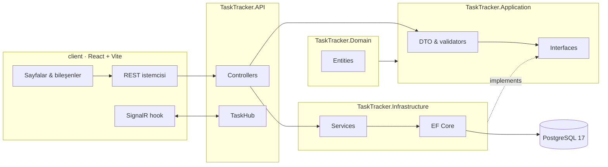

<div align="center">

# Nabız

**Küçük ekipler için gerçek zamanlı proje ve görev panosu.**

ASP.NET Core 10 · Clean Architecture · EF Core · SignalR · React 19 · TypeScript

[](https://github.com/erenpinyall/proje-yonetim-sistemi/actions/workflows/ci.yml)
[](https://dotnet.microsoft.com)
[](https://react.dev)
[](https://www.postgresql.org)
[](https://www.docker.com)

[Canlı demo](https://nabiz-demo.vercel.app/demo) · [Özellikler](#özellikler) · [Mimari](#mimari) · [Kurulum](#kurulum) · [API](#api)


</div>

> [!NOTE]
> Vercel'deki demo tarayıcıda çalışır; örnek veriler `localStorage` içinde tutulur ve canlı akış simüle edilir. Gerçek API, PostgreSQL ve SignalR akışı için [kurulum](#kurulum) bölümüne bakın.

## Nabız nedir?

Nabız, küçük ekiplerin projelerini ve görevlerini tek bir kanban panosunda yönetmesini sağlayan full-stack bir uygulamadır. Backend **ASP.NET Core 10** üzerinde **Clean Architecture** katmanlarıyla, frontend ise **React + Vite + TypeScript** ile geliştirildi.

Ürün adı **Nabız**; koddaki `TaskTracker.*` namespace ve proje adları geriye dönük uyumluluk için korunmuştur.

## Özellikler

| Alan | Neler var? |
| --- | --- |
| **Kanban** | Yapılacak / Devam Ediyor / Tamamlandı kolonları, kart detayı, durum ve öncelik değiştirme |
| **Görevler** | Oluşturma, düzenleme, silme, üyeye atama, filtreleme, sayfalama ve sıralama |
| **Ekip** | Proje üyeliği, Yönetici/Üye rolleri, e-posta ile davet, üye çıkarma |
| **Yorumlar** | Görev yorumları; kullanıcı yalnızca kendi yorumunu silebilir |
| **Gerçek zamanlı** | SignalR ile görev ve yorum olaylarında anlık bildirim |
| **Kimlik doğrulama** | JWT, BCrypt şifre hashleme, korumalı endpointler |
| **API** | FluentValidation, AutoMapper, Swagger/OpenAPI, tutarlı hata yanıtları |
| **Dağıtım** | Docker Compose ile API + PostgreSQL; Vercel'de demo build |

## Tech Stack

| Katman | Teknolojiler |
| --- | --- |
| **Backend** | ASP.NET Core 10, C# 14, Clean Architecture |
| **Veri** | Entity Framework Core 10, Npgsql, PostgreSQL 17 |
| **Kimlik & gerçek zamanlı** | JWT Bearer, BCrypt.Net, SignalR |
| **Doğrulama & eşleme** | FluentValidation, AutoMapper |
| **Frontend** | React 19, Vite 8, TypeScript 6, React Router 7 |
| **Altyapı** | Docker, Docker Compose, Vercel (demo) |
| **Dokümantasyon** | Swagger / OpenAPI |

## Mimari



**Bağımlılık yönü:** `API → Application → Domain` ve `Infrastructure → Application → Domain`. Frontend yalnızca REST ve SignalR üzerinden API ile konuşur.

## Canlı demo

**https://nabiz-demo.vercel.app/demo**

| Hesap | Şifre |
| --- | --- |
| `eren@demo.nabiz.app` | `demo1234` |
| `seda@demo.nabiz.app` | `demo1234` |
| `mert@demo.nabiz.app` | `demo1234` |
| `ayse@demo.nabiz.app` | `demo1234` |

- Demo açıldığında Eren olarak otomatik giriş yapılır.
- Veriler tarayıcının `localStorage` alanında tutulur; sayfa yenilense de korunur.
- **Demoyu sıfırla** ile başlangıç verilerine dönülür.
- Demo build'i: `cd client && npm run build:demo`

## Kurulum

### Gereksinimler

- [.NET SDK 10.0+](https://dotnet.microsoft.com/download)
- [Node.js 22+](https://nodejs.org)
- Docker Desktop **veya** PostgreSQL 17

### 1. Depoyu klonla

```bash
git clone https://github.com/erenpinyall/proje-yonetim-sistemi.git
cd proje-yonetim-sistemi
```

### 2. Sırları ayarla

Depoda gerçek parola veya JWT anahtarı **tutulmaz**. İki seçenek var:

**Docker ile:** `.env.example` dosyasını `.env` olarak kopyalayıp değerleri doldur.

```bash
cp .env.example .env
```

```dotenv
POSTGRES_PASSWORD=guclu-bir-parola
JWT_KEY=en-az-32-karakterlik-rastgele-bir-anahtar
```

> `JWT_KEY` en az 32 karakter olmalı. Üretmek için: `openssl rand -base64 48`

**Lokal API ile:** user-secrets kullan.

```bash
cd TaskTracker.API
dotnet user-secrets set "ConnectionStrings:DefaultConnection" "Host=localhost;Port=5432;Database=TaskTrackerDb;Username=postgres;Password=guclu-bir-parola"
dotnet user-secrets set "Jwt:Key" "en-az-32-karakterlik-rastgele-bir-anahtar"
```

### 3. Çalıştır

**Docker Compose (API + PostgreSQL):**

```bash
docker compose up --build
```

- API: http://localhost:8080
- Swagger: http://localhost:8080/swagger
- Health: http://localhost:8080/health

**Lokal (Docker olmadan):**

```bash
# terminal 1 — API
cd TaskTracker.API
dotnet run --urls http://localhost:8080

# terminal 2 — frontend
cd client
npm install
npm run dev
```

- Frontend: http://localhost:5173
- `/api` ve `/hubs` istekleri Vite proxy ile `http://localhost:8080` adresine gider.
- API başka bir porttaysa: `TASKTRAKER_API=http://localhost:9090 npm run dev`

> Veritabanı tabloları ilk açılışta `EnsureCreated` ile oluşturulur. Üretim ortamında migration kullanın.

## Konfigürasyon

| Anahtar | Ortam değişkeni | Not |
| --- | --- | --- |
| `ConnectionStrings:DefaultConnection` | `ConnectionStrings__DefaultConnection` | PostgreSQL bağlantı dizesi |
| `Jwt:Key` | `Jwt__Key` | En az 32 karakter |
| `Jwt:Issuer` | `Jwt__Issuer` | Varsayılan: `TaskTracker.API` |
| `Jwt:Audience` | `Jwt__Audience` | Varsayılan: `TaskTracker.Client` |
| `Cors:AllowedOrigins` | `Cors__AllowedOrigins__0`, `__1`, … | Frontend origin'leri; varsayılan `localhost:5173` |

## API

Tüm proje, görev ve yorum endpointleri JWT ister. Swagger üzerinden **Authorize** ile token girerek deneyebilirsin.

| Metot | Yol | Açıklama |
| --- | --- | --- |
| `POST` | `/api/auth/register` | Kayıt |
| `POST` | `/api/auth/login` | Giriş, JWT döner |
| `GET` | `/api/projects` | Projeleri listele (sayfalama/arama/sıralama) |
| `GET` | `/api/projects/{id}` | Proje detayı |
| `POST` | `/api/projects` | Proje oluştur |
| `DELETE` | `/api/projects/{id}` | Projeyi sil |
| `POST` | `/api/projects/{id}/members` | Üye ekle |
| `DELETE` | `/api/projects/{projectId}/members/{memberId}` | Üye çıkar |
| `GET` | `/api/projects/{projectId}/tasks` | Görevleri listele |
| `GET` | `/api/projects/{projectId}/tasks/{taskId}` | Görev detayı |
| `POST` | `/api/projects/{projectId}/tasks` | Görev oluştur |
| `PATCH` | `/api/projects/{projectId}/tasks/{taskId}` | Görev güncelle |
| `DELETE` | `/api/projects/{projectId}/tasks/{taskId}` | Görev sil |
| `GET` | `/api/tasks/{taskId}/comments` | Yorumları listele |
| `POST` | `/api/tasks/{taskId}/comments` | Yorum ekle |
| `DELETE` | `/api/tasks/{taskId}/comments/{commentId}` | Yorum sil |
| `WS` | `/hubs/tasks` | SignalR kanalı |

## Proje yapısı

```text
├── TaskTracker.API/             # Controller'lar, Program.cs, SignalR Hub
├── TaskTracker.Application/     # DTO'lar, interface'ler, validator'lar, profiller
├── TaskTracker.Domain/          # Entity'ler ve enum'lar
├── TaskTracker.Infrastructure/  # DbContext, EF konfigürasyonları, servisler
├── client/                      # React + Vite + TypeScript
│   └── src/
│       ├── api/                 # REST istemcisi
│       ├── components/          # Layout, modal, UI parçaları
│       ├── context/             # Auth & toast
│       ├── demo/                # localStorage tabanlı demo API
│       ├── hooks/               # SignalR hook
│       └── pages/               # Login, Register, Dashboard, Project
├── docs/preview.webp            # Ekran görüntüsü
├── .github/workflows/ci.yml     # API + client build
├── Dockerfile
└── docker-compose.yml
```

## Nasıl kullanılır?

1. **Demoyu aç:** [nabiz-demo.vercel.app/demo](https://nabiz-demo.vercel.app/demo) — Eren olarak otomatik giriş yapılır.
2. **Bir proje seç:** “Projeler” ekranındaki kartlardan birine gir.
3. **Görev ekle:** **Yeni Görev** ile başlık, açıklama, öncelik ve atanan kişiyi seç.
4. **Kartı yönet:** Karta tıkla; durumu **Yapılacak → Devam Ediyor → Tamamlandı** yap, yorum ekle veya sil.
5. **Ekibi davet et:** **Üyeler** sekmesinden e-posta ile üye ekle; Yönetici veya Üye rolü ver.

Uygulamanın sol menüsündeki **“Nasıl kullanılır?”** bağlantısı aynı adımları uygulama içinde de gösterir.

## Güvenlik

- Parola ve JWT anahtarı repoda tutulmaz; `.env` ve user-secrets kullanılır.
- JWT anahtarı en az 32 karakter olarak doğrulanır.
- CORS yalnızca yapılandırılan origin'lere izin verir.
- Demo verileri tarayıcıda kalır; gerçek ödeme, teslimat veya üretim verisi işlenmez.
- Bir güvenlik açığı bulursan lütfen [SECURITY.md](.github/SECURITY.md) adımlarını izle.

## Katkı

Issue açmadan önce mevcut issue'lara göz at. Değişiklik için:

```bash
git checkout -b ozellik/kisa-ad
# değişiklikleri yap
git commit -m "feat: kisa aciklama"
git push origin ozellik/kisa-ad
```

Pull request açtığında CI hem API'yi hem client'ı derler.

---

<div align="center">

**Eren Pinyal** · [GitHub](https://github.com/erenpinyall) · [LinkedIn](https://www.linkedin.com/in/eren-pinyal) · [Portfolyo](https://erenpinyal.com)

</div>
